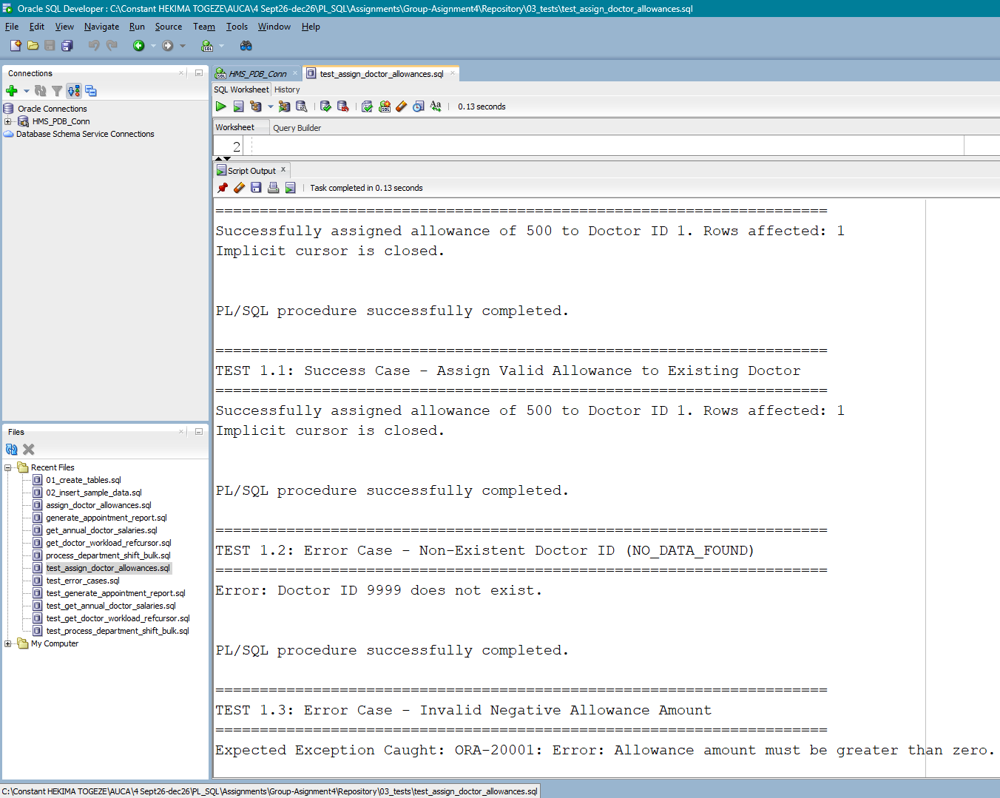
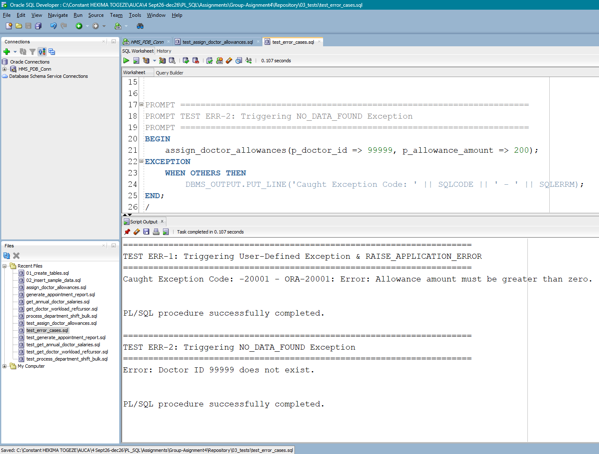
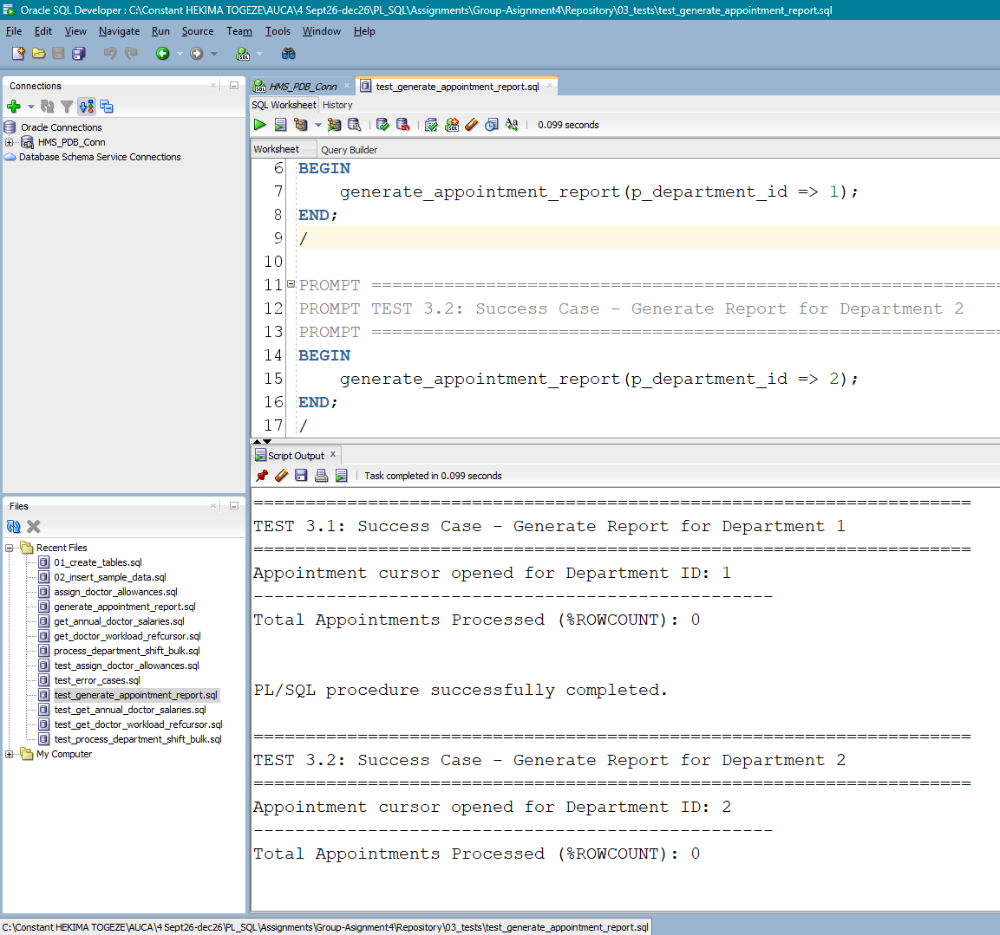
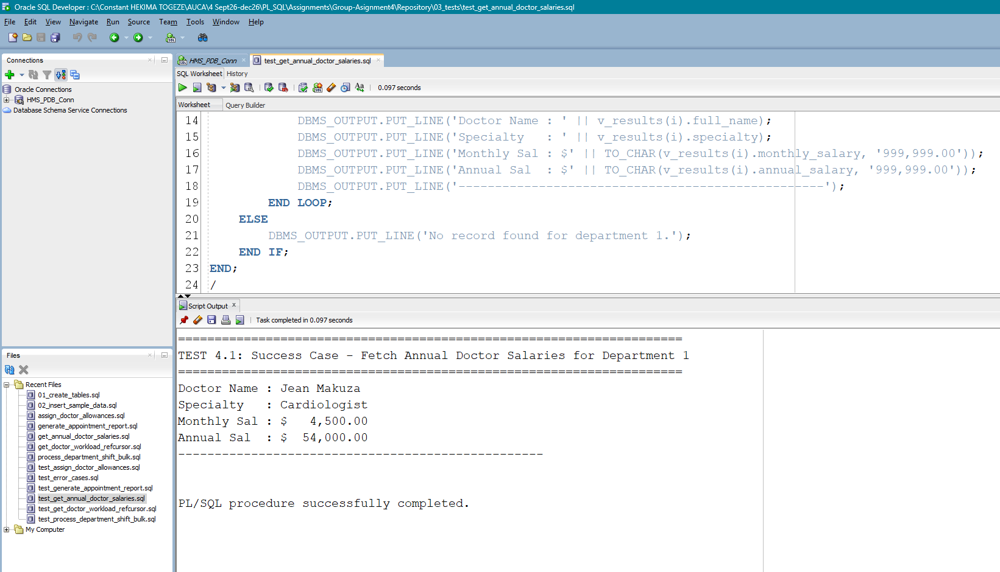
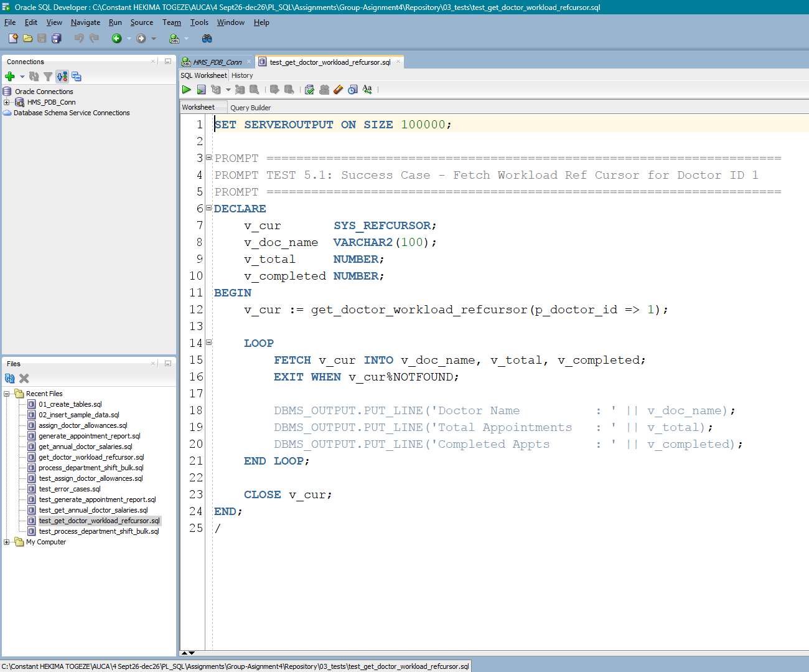
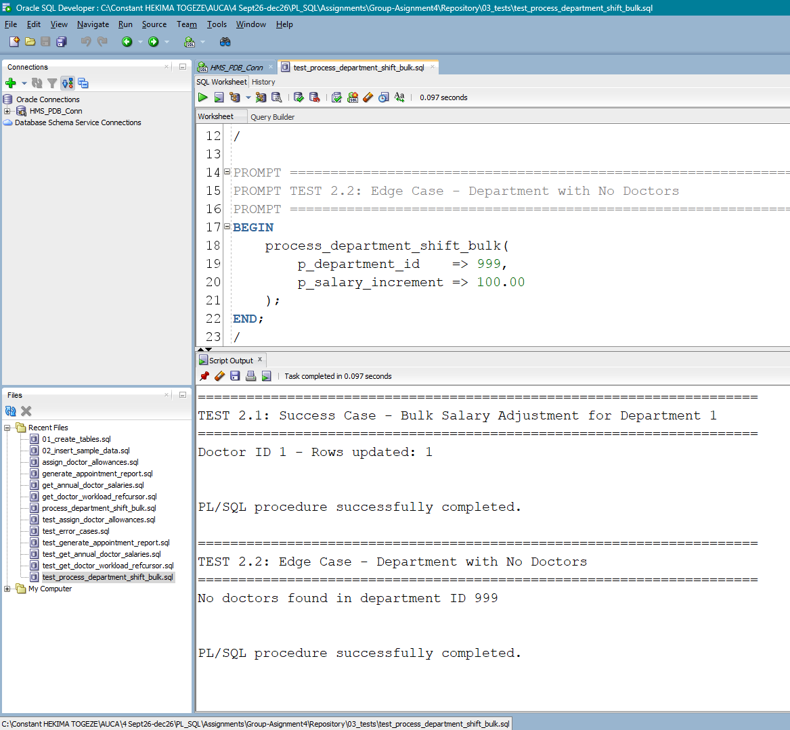

# PL/SQL Assignment IV: Advanced Oracle PL/SQL Programming - Hospital Management System (HMS)

**Course:** Database Development with PL/SQL (INSY 8311)

---

## Group Members
* **Student 1:** HEKIMA TOGEZE Constant - 29136
* **Student 2:** Ahmed Adam Yasir - 28865

---

## Application Description & Requirements
The **Hospital Management System (HMS)** manages hospital operations, including departments, doctors, patients, appointments, allowances, and attendance.

This project demonstrates:
1. **Records:** User-defined records (`TYPE`) and table-based records (`%ROWTYPE`).
2. **Collections:** Associative arrays, Nested Tables, and VARRAYS.
3. **Implicit Cursors:** Used in DML operations (`INSERT`, `UPDATE`, `DELETE`) with attributes (`SQL%ROWCOUNT`, `SQL%FOUND`, `SQL%NOTFOUND`, `SQL%ISOPEN`).
4. **Explicit Cursors:** Multi-row retrieval using `OPEN`, `FETCH`, `CLOSE`, cursor `FOR` loops, parameterized cursors, and `SYS_REFCURSOR`.
5. **Bulk Processing:** High-performance batch operations using `BULK COLLECT` and `FORALL` with `SAVE EXCEPTIONS` and `SQL%BULK_EXCEPTIONS`.
6. **Stored Procedures & Functions:** Modular business logic with input/output parameters, object types, and return values.
7. **Exception Handling:** Predefined (`NO_DATA_FOUND`, `TOO_MANY_ROWS`), user-defined exceptions, and `RAISE_APPLICATION_ERROR`.

---

## How to Run
1. Run `00_schema/01_create_tables.sql` to create the schema and object types.
2. Run `00_schema/02_insert_sample_data.sql` to populate sample records.
3. Compile all stored procedures in `01_procedures/`.
4. Compile all stored functions in `02_functions/`.
5. Run the individual test files in `03_tests/`:
   - `03_tests/test_assign_doctor_allowances.sql`
   - `03_tests/test_process_department_shift_bulk.sql`
   - `03_tests/test_generate_appointment_report.sql`
   - `03_tests/test_get_annual_doctor_salaries.sql`
   - `03_tests/test_get_doctor_workload_refcursor.sql`
   - `03_tests/test_error_cases.sql`
6. Verify if your output matches what the screenshots have.

---

## Test Execution & Results
---

### 1. Test Assign Doctor Allowances (`test_assign_doctor_allowances.sql`)
* **Explanation:** Validates the baseline procedure logic for granting doctor allowances. It verifies success cases for valid doctor assignments alongside expected exception catches for non-existent doctor IDs (`NO_DATA_FOUND`) and invalid negative allowance amounts.
* **Result Screenshot:**

---

### 2. Test Error Cases (`test_error_cases.sql`)
* **Explanation:** Evaluates system resilience against execution errors. Confirms that `RAISE_APPLICATION_ERROR` and standard PL/SQL exceptions trigger properly and output user-defined error messages without breaking the database session.
* **Result Screenshot:**

---

### 3. Test Generate Appointment Report (`test_generate_appointment_report.sql`)
* **Explanation:** Tests the creation of structured appointment reporting procedures across multiple department parameters (Department 1 and Department 2) to ensure clean reporting logs.
* **Result Screenshot:**

---

### 4. Test Get Annual Doctor Salaries (`test_get_annual_doctor_salaries.sql`)
* **Explanation:** Verifies object-type collections (`doctor_salary_table`) and functions calculating annual earnings. Iterates over returned record collections and formats monthly and annual salary metrics.
* **Result Screenshot:**

---

### 5. Test Get Doctor Workload Refcursor (`test_get_doctor_workload_refcursor.sql`)
* **Explanation:** Validates dynamic cursor returning mechanisms via `SYS_REFCURSOR`. Ensures workload metrics (total vs. completed appointments per doctor) fetch and close cleanly without memory leaks.
* **Result Screenshot:**

---

### 6. Test Process Department Shift Bulk (`test_process_department_shift_bulk.sql`)
* **Explanation:** Tests high-performance bulk operations (`FORALL` / `SAVE EXCEPTIONS`) when processing department-wide salary increments and handling edge cases like empty or invalid departments.
* **Result Screenshot:**

---

---

## AI Assistance Statement
An AI assistant helped with about **30% to 35%** of the work, mainly for checking syntax and formatting the notes. The group did **70% to 75%** of the actual coding, design, and testing independently. Both group members fully understand and have tested all the code."# plsql-assignment4-29136-28865" 
